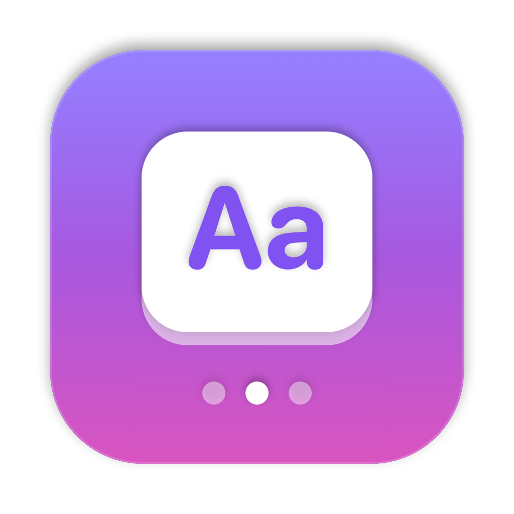
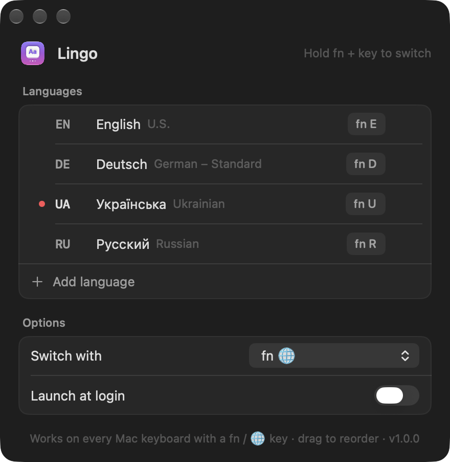

<p align="center">
  
</p>

<h1 align="center">Lingo</h1>

<p align="center">
  Hold fn, press a letter — switch keyboard language.<br>
  <sub>Tiny · Free · Open source · macOS 14+</sub>
</p>

<p align="center">
  <a href="https://buhaenko.github.io/lingo/">Website</a> ·
  <a href="https://github.com/buhaenko/lingo/releases/latest">Download</a>
</p>

<p align="center">
  
</p>

## Install

```sh
curl -fsSL https://buhaenko.github.io/lingo/install.sh | bash
```

That’s it — Lingo lands in Applications and appears in the menu bar.
Prefer a DMG? Grab it from [Releases](https://github.com/buhaenko/lingo/releases/latest).

## Use

Every language gets its own key. No cycling, no guessing.

| | |
|---|---|
| **fn E** | English |
| **fn D** | Deutsch |
| **fn U** | Українська |

On first launch Lingo picks up the layouts you already use and suggests keys.
Any layout, any letter — and if fn isn’t your thing, switch with **⌃**, **⌥** or **⌃⌥** instead.

The menu bar shows the current language with a dot for each one you have: `DE ○●○`.

Updates install themselves: once a day Lingo checks the latest release, verifies its signature and restarts into the new version.
Turn it off in Settings, or use *Check for Updates…* in the menu.

## Privacy

Lingo never sends what you type anywhere — no analytics, no accounts. Its only network request is a daily check on GitHub
for a new version (turn it off in Settings). It needs **Accessibility**, so the letter you press with fn switches the layout
instead of being typed — it only reacts to your shortcuts and never records what you type.

## Build from source

```sh
scripts/test.sh          # 78 unit + integration tests
scripts/build.sh 1.0.0   # → build/Lingo.app, Lingo.dmg, Lingo.zip
```

Plain Swift, no dependencies, no Xcode project. Releases are built by
[GitHub Actions](.github/workflows/release.yml) from this repository.

## License

[MIT](LICENSE)
